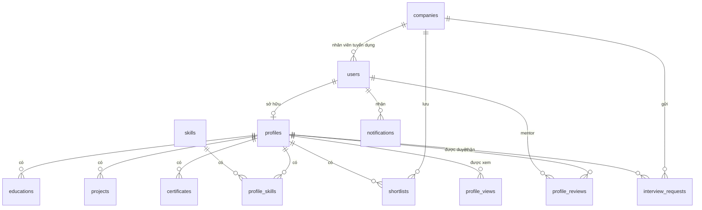
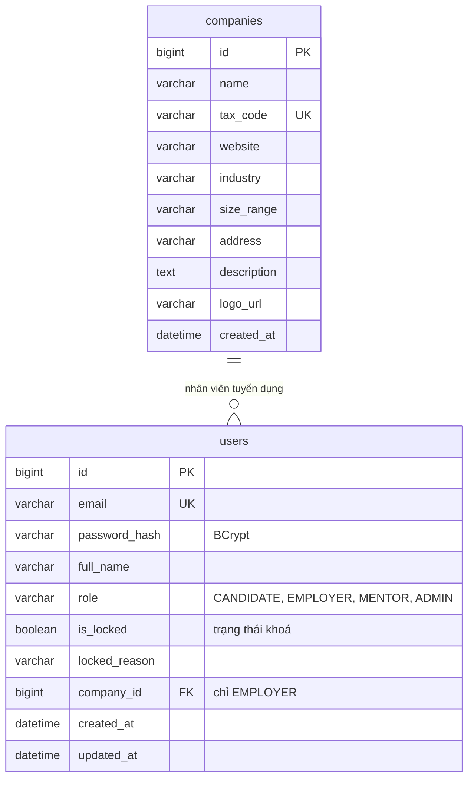
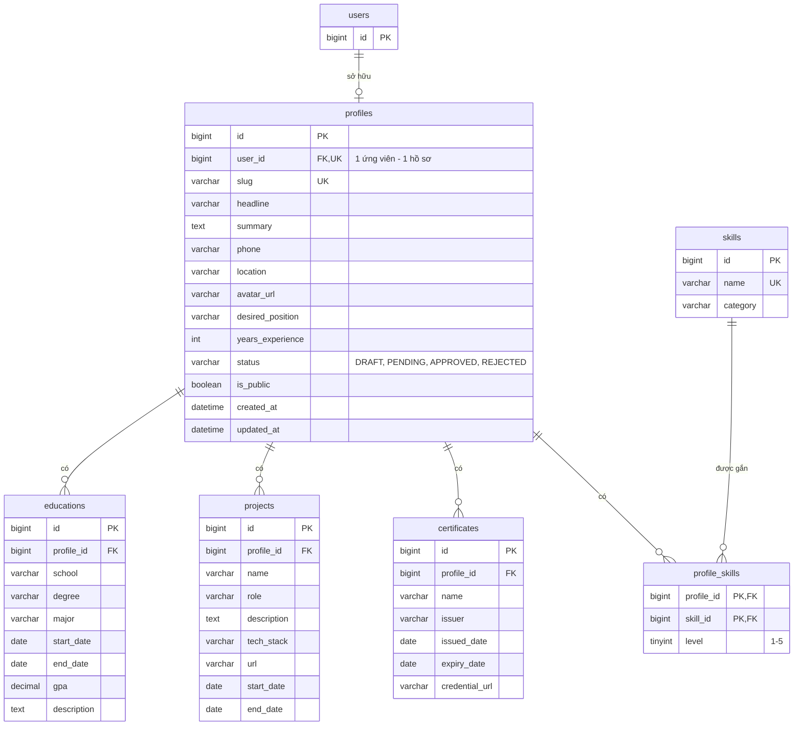
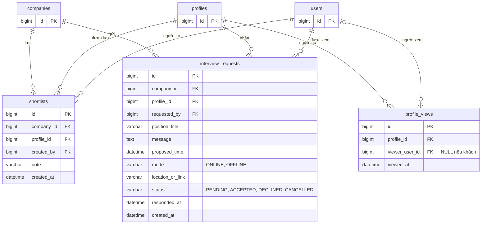
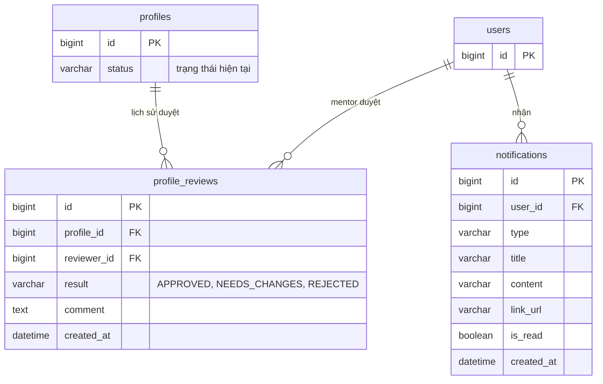

# Thiết kế CSDL – Career Connect

> Task: **T4E7960** · Hệ quản trị: MySQL 8 (InnoDB, utf8mb4) · Trạng thái: đã chốt, dùng làm căn cứ viết migration

## 1. Tổng quan

Hệ thống có 4 vai trò người dùng:

| Vai trò | Làm gì |
| --- | --- |
| `CANDIDATE` | Tạo hồ sơ năng lực (học vấn, kỹ năng, dự án, chứng chỉ), gửi duyệt, nhận lời mời phỏng vấn |
| `EMPLOYER` | Thuộc một công ty, tìm hồ sơ, lưu shortlist, gửi lời mời phỏng vấn |
| `MENTOR` | Duyệt hồ sơ ứng viên (đạt / yêu cầu sửa / từ chối) |
| `ADMIN` | Quản lý tài khoản, khoá/mở khoá |

Quy ước chung:
- Khoá chính `id BIGINT AUTO_INCREMENT`.
- Mọi bảng có `created_at DATETIME DEFAULT CURRENT_TIMESTAMP`; bảng hay sửa có thêm `updated_at`.
- Giá trị liệt kê (vai trò, trạng thái) lưu `VARCHAR(20)` + Java `enum` (`@Enumerated(EnumType.STRING)`), không dùng kiểu `ENUM` của MySQL để dễ thêm giá trị mới qua migration.
- Tên bảng số nhiều, chữ thường, `snake_case`.

## 2. Sơ đồ ERD

Sơ đồ được chia làm 5 phần cho dễ đọc: một sơ đồ tổng quan chỉ có tên bảng và quan hệ, sau đó là sơ đồ chi tiết của từng cụm. Trong sơ đồ chi tiết, bảng thuộc cụm khác chỉ hiện cột `id` để thể hiện liên kết.

Ký hiệu: `||` = đúng một, `o|` = không hoặc một, `o{` = không hoặc nhiều.

### 2.1 Tổng quan

### 2.2 Cụm tài khoản

### 2.3 Cụm hồ sơ năng lực

### 2.4 Cụm tuyển dụng

### 2.5 Cụm kiểm duyệt và thông báo

## 3. Mô tả bảng

| Bảng | Mục đích |
| --- | --- |
| `users` | Tài khoản đăng nhập của mọi vai trò; `is_locked` + `locked_reason` là trạng thái khoá |
| `companies` | Thông tin công ty; nhiều nhà tuyển dụng có thể thuộc một công ty |
| `profiles` | Hồ sơ năng lực, 1–1 với tài khoản ứng viên; `status` là trạng thái duyệt hiện tại |
| `educations` | Quá trình học tập của hồ sơ |
| `skills` | Danh mục kỹ năng dùng chung (Java, SQL, Giao tiếp...) để lọc/tìm kiếm thống nhất |
| `profile_skills` | Bảng nối nhiều–nhiều hồ sơ ↔ kỹ năng, kèm mức thành thạo `level` 1–5 |
| `projects` | Dự án ứng viên đã làm |
| `certificates` | Chứng chỉ của ứng viên |
| `shortlists` | Hồ sơ mà công ty đã lưu lại để cân nhắc |
| `interview_requests` | Lời mời phỏng vấn công ty gửi tới ứng viên và trạng thái phản hồi |
| `profile_reviews` | **Lịch sử** các lần mentor duyệt hồ sơ (mỗi lần duyệt là một dòng, không ghi đè) |
| `notifications` | Thông báo trong hệ thống gửi tới người dùng |
| `profile_views` | Nhật ký lượt xem hồ sơ, dùng để thống kê cho ứng viên |

## 4. Khoá ngoại

| Bảng.cột | Tham chiếu | Quan hệ | Khi xoá bản ghi cha | Lý do |
| --- | --- | --- | --- | --- |
| `users.company_id` | `companies.id` | N–1, có thể NULL | `SET NULL` | Chỉ EMPLOYER mới thuộc công ty; xoá công ty không xoá tài khoản |
| `profiles.user_id` | `users.id` | 1–1 (thêm `UNIQUE`) | `CASCADE` | Mỗi ứng viên chỉ có một hồ sơ; xoá tài khoản thì xoá hồ sơ |
| `educations.profile_id` | `profiles.id` | N–1 | `CASCADE` | Dữ liệu con, không có nghĩa khi mất hồ sơ |
| `projects.profile_id` | `profiles.id` | N–1 | `CASCADE` | Như trên |
| `certificates.profile_id` | `profiles.id` | N–1 | `CASCADE` | Như trên |
| `profile_skills.profile_id` | `profiles.id` | N–N (bảng nối) | `CASCADE` | Như trên |
| `profile_skills.skill_id` | `skills.id` | N–N (bảng nối) | `RESTRICT` | Không cho xoá kỹ năng đang được dùng |
| `shortlists.company_id` | `companies.id` | N–1 | `CASCADE` | Shortlist thuộc về công ty |
| `shortlists.profile_id` | `profiles.id` | N–1 | `CASCADE` | Hồ sơ mất thì bỏ khỏi shortlist |
| `shortlists.created_by` | `users.id` | N–1 | `RESTRICT` | Giữ dấu vết ai đã lưu |
| `interview_requests.company_id` | `companies.id` | N–1 | `RESTRICT` | Giữ lịch sử tuyển dụng |
| `interview_requests.profile_id` | `profiles.id` | N–1 | `RESTRICT` | Giữ lịch sử tuyển dụng |
| `interview_requests.requested_by` | `users.id` | N–1 | `RESTRICT` | Giữ dấu vết người gửi |
| `profile_reviews.profile_id` | `profiles.id` | N–1 | `CASCADE` | Lịch sử duyệt gắn với hồ sơ |
| `profile_reviews.reviewer_id` | `users.id` | N–1 | `RESTRICT` | Không mất thông tin mentor đã duyệt |
| `notifications.user_id` | `users.id` | N–1 | `CASCADE` | Thông báo thuộc về người nhận |
| `profile_views.profile_id` | `profiles.id` | N–1 | `CASCADE` | Nhật ký gắn với hồ sơ |
| `profile_views.viewer_user_id` | `users.id` | N–1, có thể NULL | `SET NULL` | Khách chưa đăng nhập vẫn được tính lượt xem |

Ràng buộc kiểm tra: `profile_skills.level BETWEEN 1 AND 5` (CHECK, MySQL 8.0.16+).

Tài khoản bị khoá **không xoá cứng** mà dùng `users.is_locked`, nên các `RESTRICT` ở trên không cản trở vận hành bình thường.

## 5. Index chính

MySQL (InnoDB) tự tạo index cho khoá chính và cho cột khoá ngoại nếu chưa có index phù hợp. Bảng dưới liệt kê các index **cần tạo thêm** vì truy vấn thường dùng:

| Bảng | Index | Loại | Phục vụ truy vấn |
| --- | --- | --- | --- |
| `users` | `(email)` | UNIQUE | Đăng nhập, chống trùng email |
| `users` | `(role, is_locked)` | Thường | Admin lọc tài khoản theo vai trò/trạng thái |
| `companies` | `(tax_code)` | UNIQUE | Chống tạo trùng công ty |
| `profiles` | `(user_id)` | UNIQUE | Đảm bảo quan hệ 1–1 |
| `profiles` | `(slug)` | UNIQUE | Mở hồ sơ công khai theo đường dẫn |
| `profiles` | `(status, is_public)` | Thường | Mentor xem hồ sơ chờ duyệt; nhà tuyển dụng chỉ thấy hồ sơ đã duyệt và công khai |
| `skills` | `(name)` | UNIQUE | Không trùng tên kỹ năng, tìm theo tên |
| `profile_skills` | `(profile_id, skill_id)` | PRIMARY | Mỗi kỹ năng chỉ gắn một lần vào một hồ sơ |
| `profile_skills` | `(skill_id, level)` | Thường | Tìm ứng viên có kỹ năng X với mức ≥ N |
| `shortlists` | `(company_id, profile_id)` | UNIQUE | Một công ty không lưu trùng một hồ sơ |
| `interview_requests` | `(profile_id, status)` | Thường | Ứng viên xem lời mời đang chờ |
| `interview_requests` | `(company_id, status)` | Thường | Công ty xem lời mời đã gửi theo trạng thái |
| `profile_reviews` | `(profile_id, created_at)` | Thường | Xem lịch sử duyệt theo thời gian |
| `notifications` | `(user_id, is_read, created_at)` | Thường | Đếm và liệt kê thông báo chưa đọc mới nhất |
| `profile_views` | `(profile_id, viewed_at)` | Thường | Thống kê lượt xem theo khoảng thời gian |

## 6. Quyết định thiết kế

| Vấn đề | Quyết định | Lý do |
| --- | --- | --- |
| Nhà tuyển dụng thuộc mấy công ty? | **Một công ty** (`users.company_id`, quan hệ N–1) | Đúng thực tế: một người tuyển dụng làm cho một công ty, và một công ty có thể có nhiều người tuyển dụng. Nếu sau này cần một người quản lý nhiều công ty thì thêm bảng nối `company_members`, không phải sửa các bảng khác. |
| Mỗi ứng viên có mấy hồ sơ? | **Một hồ sơ** (`profiles.user_id` UNIQUE, quan hệ 1–1) | Hồ sơ năng lực là trang giới thiệu bản thân duy nhất của ứng viên, không phải nhiều CV cho từng vị trí. Một hồ sơ cũng giúp việc duyệt, thống kê lượt xem và đường dẫn công khai (`slug`) đơn giản, không nhập nhằng. |
| Có làm bảng tin tuyển dụng (`job_posts`) không? | **Không** trong phạm vi task này | Danh sách bảng của task không có tin tuyển dụng. Hệ thống đi theo hướng nhà tuyển dụng chủ động tìm hồ sơ và gửi lời mời; vị trí tuyển được ghi ở `interview_requests.position_title`. Nếu cần sẽ thêm ở sprint sau. |
| Có xoá cứng tài khoản không? | **Không**, dùng `users.is_locked` | Giữ lại lịch sử duyệt và lời mời phỏng vấn; khoá và mở khoá dễ dàng. |
| Lưu vai trò, trạng thái bằng kiểu gì? | **`VARCHAR(20)`** + Java `enum` | Thêm giá trị mới chỉ cần sửa code, không phải `ALTER` kiểu `ENUM` của MySQL. |
